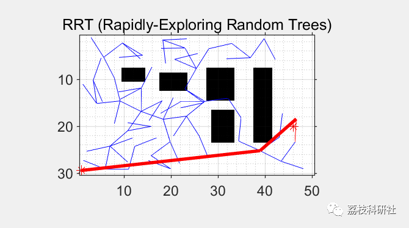

# Path Planning Based on Extended Random Tree (RRT) Algorithm (Matlab Code Implementation)

💥💥💥💞💞💞💞 Welcome to this blog❤️❤️❤️💥💥💥
🏆 Bloggers' Advantage: 🌞🌞🌞 The content of the blog strives to be rigorous in thought and clear in logic, for the convenience of readers.
⛳️ Mantra: The journey of a hundred miles is half done in the last ninety.
Litchi Research Society
Code Collection: Power System, Intelligent Algorithms and Applications, Neural Network Prediction, Path Planning, Optimized Scheduling, Workshop Scheduling, Image Processing, Signal Processing...
🎁Column Directory Link:
🌈🌈🌈🌟🌟🌟🛫🛫🛫🛫🛫🛫🛫🛫🛫🛫🛫🛫🛫🛫🛫🛫🛫🛫🛫🛫🛫🛫🛫🛫🛫🛫🛫🛫🛫🛫🛫🛫🛫🛫🛫🛫🛫🛫🛫🛫🛫🛫🛫🛫🛫🛫🛫🛫🛫🛫🛫🛫🛫🛫🛫🛫🛫🛫🛫🛫🛫🛫🛫🛫🛫🛫🛫🛫🛫🛫🛫🛫🛫🛫🛫🛫🛫🛫🛫🛫🛫🛫🛫🛫🛫🛫🛫🛫🛫🛫🛫🛫🛫🛫🛫🛫🛫🛫🛫🛫🛫🛫🛫🛫🛫🛫🛫🛫🛫🛫🛫🛫🛫🛫🛫🛫🛫🛫🛫🛫🛫🛫🛫🛫🛫🛫🛫🛫🛫🛫🛫🛫🛫🛫🛫🛫🛫🛫🛫🛫🛫🛫🛫🛫🛫🛫🛫🛫🛫🛫🛫🛫🛫🛫🛫🛫🛫🛫🛫🛫🛫🛫🛫🛫🛫🛫🛫🛫🛫🛫🛫🛫🛫🛫🛫🛫🛫🛫🛫🛫🛫🛫🛫🛫🛫🛫🛫🛫🛫🛫🛫🛫🛫🛫🛫🛫🛫🛫🛫🛫🛫🛫🛫🛫🛫🛫🛫🛫🛫🛫🛫🛫🛫🛫🛫🛫🛫🛫🛫🛫🛫🛫🛫🛫🛫🛫🛫🛫🛫🛫🛫🛫🛫🛫🛫🛫🛫🛫🛫🛫🛫🛫🛫🛫🛫🛫🛫🛫🛫🛫🛫🛫🛫🛫🛫🛫
💥1 Overview
📚2 Running Results
🎉3 References
👨‍💻4 Matlab code implementation
💥1 Overview
Mobile robot path planning is one of the key technologies for achieving autonomous navigation for robots. Its objective is to find an optimal or near-optimal path from the starting point to the destination, taking into account performance metrics such as path length, search time, smoothness, and obstacle avoidance capabilities in a constrained environment with obstacles.
Traditional mobile robot path planning algorithms include Dijkstra's algorithm, genetic algorithms, A* algorithm, particle swarm optimization, etc. However, in the context of complex constraint robotic applications, these algorithms often require substantial computational power. The Rapidly-Exploring Random Tree (RRT) algorithm proposed by Lavalle expands the search space gradually to the accessible area through random collision detection within the state space (Tree, RRT). This approach avoids modeling the planning space and achieves fast execution speed, making it widely used in mobile robot path planning. This paper implements path planning based on the extended random tree (RRT) algorithm using MATLAB code.
📚2 Running Results
​  
🎉4 References
[1] Zhang Zhiwei, Jia Yunwei, Wang Yongxia, Fu Bangpeng. Fast Path Planning Algorithm Based on Improved Rapidly Expanding Random Tree [J]. Journal of Tianjin University of Technology, 2022, 38(03): 14-19.  
[2] Hou Yuxiang, Gao Huanbing, Wang Zijian, Du Chuansheng. Path Planning Algorithm for Mobile Robots with Improved RRT [J]. Electronic Measurement Technology, 2022, 45(16): 47-52. DOI: 10.19651/j.cnki.emt.2209355.  
👨‍💻4 MATLAB Code Implementation
Click the article's lower left corner to read more.

## Images

<!-- PAYMENT_BLOCK -->

## Get this dataset

- Payment link (Stripe): [Buy now](https://buy.stripe.com/3cs8yP7sY87d0vu9AB)
- Payment QR code: 

<!-- /PAYMENT_BLOCK -->
